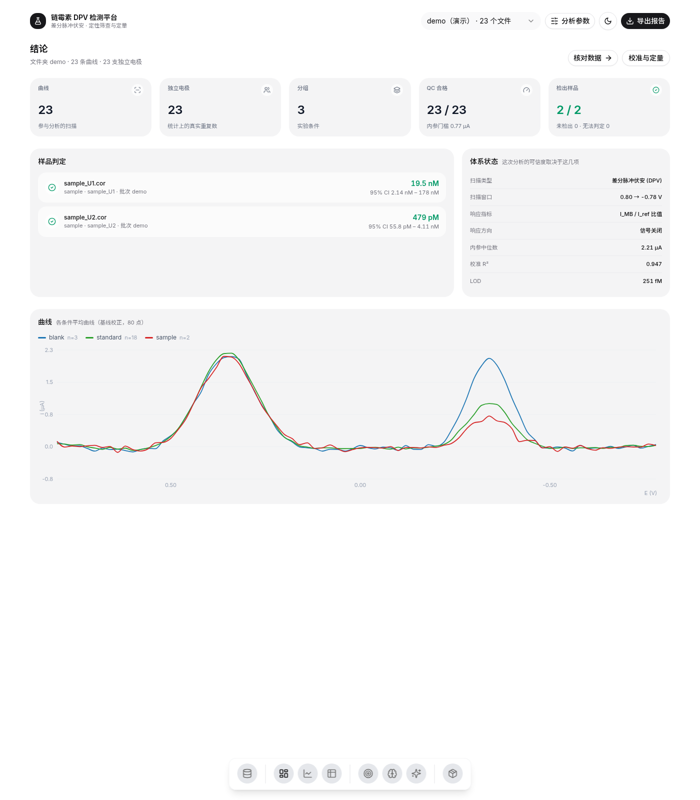
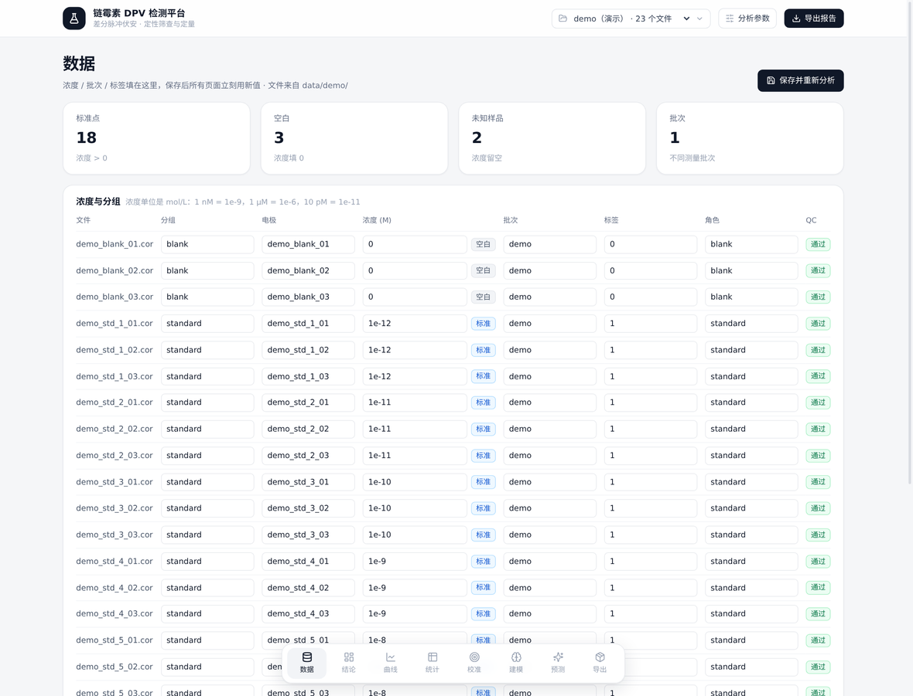
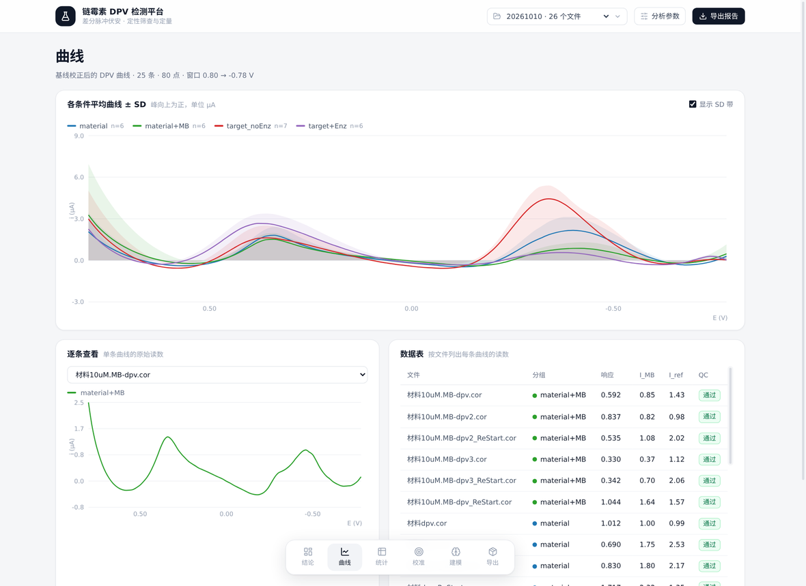
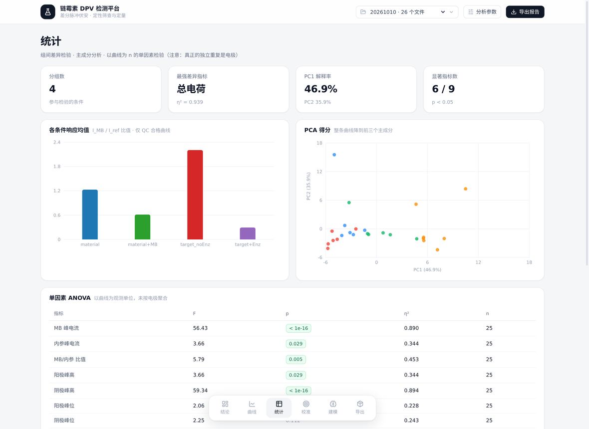
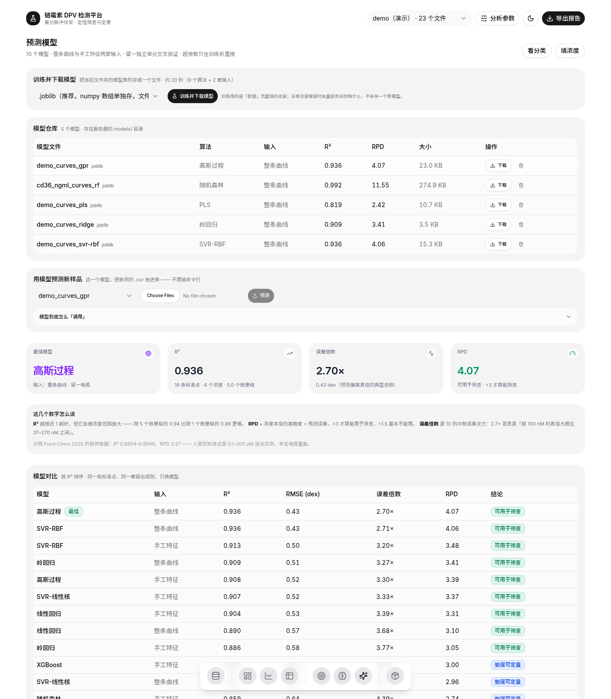
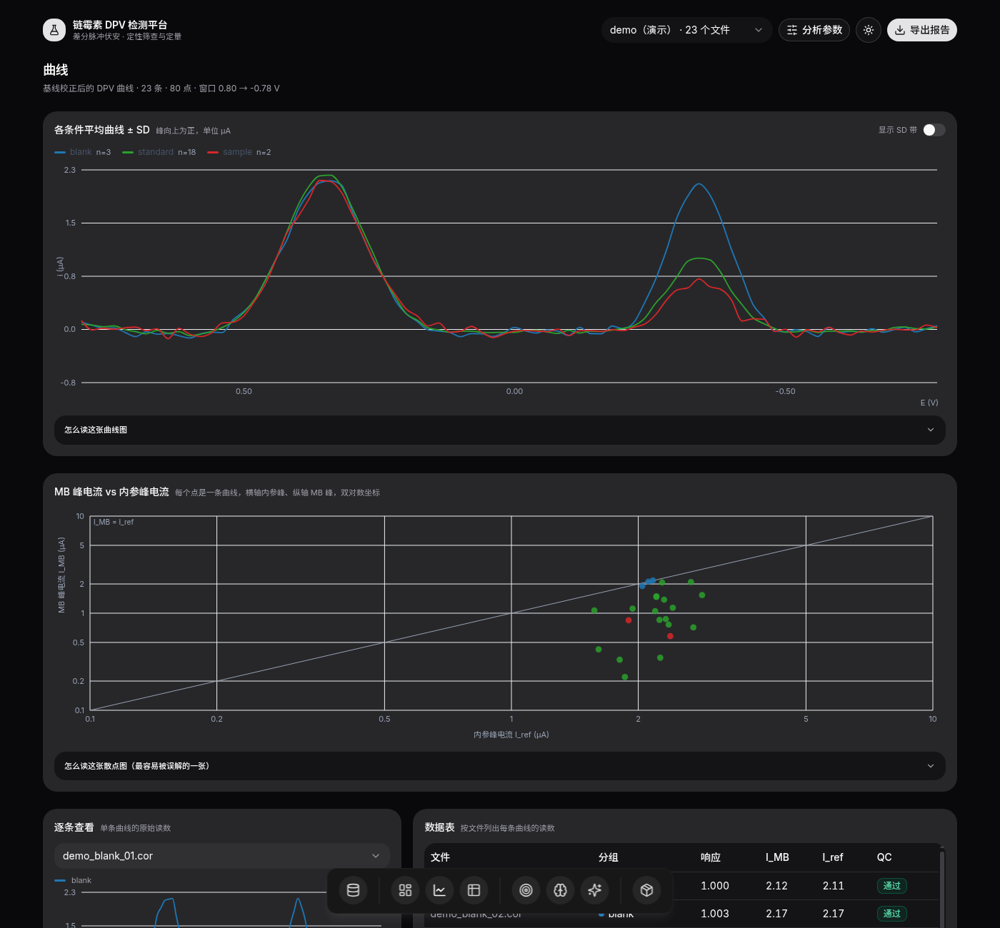

# DPV 电化学生物传感器分析平台

**把辰华 CHI 的 `.cor` 原始曲线，变成「检出 / 未检出 + 浓度 + 置信区间」的完整流水线。**
解析 → 基线校正 → 找峰 → 统计检验 → 校准曲线与 LOD → 机器学习定量 → 可发表的报告，全部带**按电极 / 按批次切分的诚实验证**。

> A self-hostable toolkit for electrochemical biosensor data (DPV / SWV / CV from CHI instruments).
> Parses raw `.cor` files, does baseline correction and peak picking, runs the statistics,
> builds calibration curves with proper LOD, trains validated regression models, and serves it all
> through a self-hostable web UI. Validation is grouped by **electrode** and **batch**, never by
> individual scan — because that is where most published numbers quietly break.

**许可**：软件 [GPL-3.0](LICENSE) · 文档与数据 [CC BY 4.0](LICENSE-DOCS.md)



<p align="center"><sub>「结论」页：每个未知样品一张卡 —— 检出 / 未检出 / 无法判定，附浓度和 95% 区间。给不出浓度时会说明缺什么，而不是编一个数。</sub></p>

---

## 这是什么

一个**自托管**的数据分析平台。你手上是一堆电化学工作站导出的曲线文件，想知道样品里有没有目标物、有多少；
它负责把这堆文件变成下面这张表：

| 文件 | 判定 | 浓度 | 95% 区间 |
|---|---|---|---|
| sample_U1.cor | 检出 | 19.5 nM | 4.9 – 78 nM |
| sample_U2.cor | 检出 | 479 pM | 273 pM – 1.99 nM |
| blank_01.cor | 未检出 | — | — |

以及一份可以贴进论文 / 交给审稿人的报告：图、统计表、校准参数、模型指标、原始数据，打包成 zip。

**给谁用**：做电化学传感器（适配体 / 免疫 / 酶 / MIP）的研究生和分析化学实验室。
**不假设**：不假设你的体系是链霉素，不假设你有浓度梯度，也不假设你的数据干净 ——
条件不够时它会明确说「这批数据回答不了这个问题」，并列出缺什么。

---

## 它解决什么问题

| 常见做法 | 问题 | 这个工具怎么做 |
|---|---|---|
| 工作站软件导出 Excel，手画校准线 | 只能画图，没有统计、没有验证 | 全流程自动化，一条命令 / 一个网页 |
| 把每一条扫描当独立样本 | **伪重复**：同一支电极扫 3 次算 3 个 n，p 值和 R² 全部虚高 | 默认以**电极**为独立单位，留一电极交叉验证 |
| 用 `LOD = 3.3·Syx/b` | 隐含校准线过原点，截距在别处时算出 10² M 这种荒谬值 | 用**空白 3σ 反算**浓度，空白不足 3 条就拒绝给数 |
| 报「交叉验证准确率 84%」 | 同一支电极的曲线同时出现在训练集和测试集 | 留一电极 + **电极级置换检验**（给零分布和 p 值） |
| 不同日期做的数据混在一起建模 | 批次效应被当成生物学信号 | 方差分解量化批次占比，支持**按批标定**和留一批次验证 |
| 只报 R² | 浓度跨 5 个数量级时 R² 会骗人 | 同时报 RMSE、MAE、**RPD**、误差倍数、每折离散 |

---

## 界面

七个功能页 + 一个数据页，全部在同一个 Web 应用里，不需要装客户端。

| | |
|---|---|
|  |  |
| **数据**：可编辑表格（分组 / 电极 / 浓度 / 批次 / 标签），直接保存回 `metadata.csv` | **曲线**：基线校正后的全部曲线、均值 ± SD、双峰比值散点 |
|  |  |
| **统计**：ANOVA、Tukey HSD、效应量 η²、PCA、箱线图 | **预测**：9 种回归模型 × 2 套输入，R²/RPD/学习曲线/特征重要性 |
|  | |
| **训练并下载模型**：浏览器里点一下，后台训练、轮询进度、下载 `.joblib`；再用它给新样品打分 | |

另外三页：**结论**（每样品判定）、**校准**（校准曲线 + LOD/LOQ + 逆回归区间）、**导出**（zip 报告）。

八页全部由**底部一条悬浮 dock** 切换（图标鼠标移上去会放大并浮出名字，组间有细竖线分隔），
右上角一键切深色主题：



---

## 快速开始

### 方式一：Docker（服务器 / 长期部署）

一个镜像装好前端 + 后端 + Python 依赖，服务器只要装了 Docker：

```bash
# 现成的镜像（1.69 GB，纯 CPU），不用编译
docker pull ghcr.io/aa932406/dpv-streptomycin:latest
docker run -d --name dpv --restart unless-stopped \
  -p 3000:3000 -v dpv_data:/app/data dpv-streptomycin:latest
```

包是私有的，第一次拉要 `docker login ghcr.io -u aa932406`（PAT 勾 read:packages）。
想自己构建：`git clone` 后 `docker build -t dpv-streptomycin:latest .`，两条路效果一样。

打开 `http://<服务器IP>:3000`。**不需要 GPU**：整套东西是纯 CPU 的（numpy / scipy /
scikit-learn / matplotlib + CPU 版 xgboost），没有 CUDA、没有 torch，一张 2 核 2G 的机器就够。
离线服务器用 `docker save | gzip` 拷过去，或者推到镜像仓库让服务器 `docker pull`。
细节见 [docs/部署说明_Docker.md](docs/部署说明_Docker.md)。

### 方式二：网页界面（Windows 双击，零命令行）

```bash
git clone https://github.com/aa932406/dpv-streptomycin.git
cd dpv-streptomycin
run_web.bat          # Windows：双击即可，自动建环境、装依赖、构建前端
```

Linux / macOS：

```bash
python3 -m venv .venv && .venv/bin/pip install -r requirements.txt
cd web && npm install && npm run build && cd ..
.venv/bin/python -m uvicorn server.app:app --port 8000 &     # API
cd web && npm run start &                                    # 前端 → http://127.0.0.1:3000
```

打开页面后点侧栏的「**生成演示数据**」，立刻有一套带浓度梯度的合成数据可以走完整流程
（真实数据往往没有浓度梯度，见下面的「参考应用」）。

数据在「**数据**」页填：浓度 / 批次 / 标签三种填法直接写在表头和图例里。一批几十个样品不用一行行改 ——
「按分组全选」「从文件名提取（正则 + 单位换算）」「粘贴整列」三种批量方式，改完点保存即可。

### 方式三：命令行 / 当库用

```bash
python scripts/dpv_pipeline.py --data data/20261010     # 统计 + 出图 → out/20261010/
python scripts/ratiometric_calibration.py --meta metadata/metadata.csv   # 校准 + LOD
python scripts/cross_batch.py                           # 跨批次：方差来源 / 重复性 / 留一批次
python scripts/train_model.py --data data/demo          # 训练 → models/*.joblib
python scripts/predict_with_model.py --model models/x.joblib --data <新样品文件夹>
```

```python
import sys; sys.path.insert(0, "scripts")
from dpv_pipeline import parse_cor, baseline_envelope, resample, GRID
from analysis_core import analyse_trace, build_table, fit_calibration

row, y, icorr = analyse_trace("sample.cor", open("sample.cor","rb").read())
print(row["ratio"], row["I_MB"], row["I_ref"])
```

### 方式四：HTTP API

```bash
curl "http://127.0.0.1:8000/api/analyse?folder=20261010"     # 全部结果（JSON）
curl "http://127.0.0.1:8000/api/regression?folder=demo"       # 模型对比
curl -X POST http://127.0.0.1:8000/api/train -H 'Content-Type: application/json' \
     -d '{"folder":"demo"}'                                   # 后台训练 → 返回 job_id
curl "http://127.0.0.1:8000/api/train/<job_id>"               # 轮询
```

---

## 支持的数据

- **辰华 CHI** `.cor`（文本格式，DPV / SWV / CV / 溶出伏安都能读；同一文件夹里混着多种技术也能自动分开）
- 不同日期文件夹的扫描窗口不同（0.09→−0.50、0.19→−0.20、0.60→−0.59 …）也没关系：
  窗口盖不到目标峰或内参峰时，自动换响应指标、自动跳过内参 QC，并在页面上说明原因
- 元数据（浓度 / 批次 / 电极 / 标签）写在 `metadata.csv`，也可以在界面里填

`.cor` 有两个坑，代码已经处理：数据行在 `End Comments` **之后**；文件要用 `latin1` 解码。
还有的导出完全没有表头，按 DPV 兜底，否则会被当成「别的技术」丢掉。

---

## 方法学：这个工具凭什么值得信

这是整个项目最在意的部分。默认行为全部选**保守**的那一边：

- **独立单位是电极，不是扫描** —— 同一支电极重复扫（`_ReStart`）算一次
- **留一电极 / 留一批次交叉验证**，报告里同时给出瞎猜水平和样本量
- **置换检验**：按电极打乱标签重跑 N 次，给出零分布和 p 值（而不是只报一个准确率）
- **平衡准确率**：类别不平衡时，原始准确率会被大类主导（演示数据里原始 65% 而平衡只有 28%，低于瞎猜）
- **LOD 用空白 3σ 反算**，空白 < 3 条直接拒绝；结果超出校准范围 10 倍也拒绝，不给假数字
- **按批标定**：多批次时每批用自己的标准点定截距（共享斜率），并报留一批次 RMSE
- **模型卡**：训练出的模型带适用范围、交叉验证指标、空白分布和检出阈值，脱离数据也能审计

---

## 参考应用：链霉素适配体传感器

仓库里的真实数据来自一个具体课题 —— 用 **Au@SH-MIL-101(Fe)** 修饰电极、
三螺旋 DNA 开关 + 双发夹探针（末端标亚甲基蓝）+ 核酸外切酶 III，检测食品中的**链霉素**。
这部分既是本工具的用例，也是一份**诚实的阴性结果**（详细分析见 [docs/分析说明_v3_机理.md](docs/分析说明_v3_机理.md)）：

| 发现 | 数字 |
|---|---|
| 两个峰只差 70–110 mV，而峰宽就有 80–100 mV | 20 mV 步进下严重重叠，需要 5 mV 或解卷积 |
| 加 Exo III 后信号**掉 7.4 倍**，与「信号开启」的设计方向相反 | 2.21 → 0.30（p ≈ 1.5e-06） |
| 电极读的是吸附在 DNA 上的 MB，不是游离 MB | 游离 MB 0.59 < 裸电极 1.27；切碎 DNA 后 0.30 |
| 变异的 **56%** 来自「哪一天做的」 | 跨批 AUC 0.51，同批 0.73，留一批次 38% |
| 15 个真实数据集**全部没有浓度梯度** | 所以一个浓度也算不出来（工具会如实说明） |

277 个 `.cor` → 220 条可用曲线 → **91 支独立电极**。数据本身没问题，缺的是实验设计
（见 [docs/数据采集方案_ML.md](docs/数据采集方案_ML.md)：一天能做完的最小出浓度实验是 **9 支电极**）。

---

## 项目结构

```
scripts/            Python 核心（不依赖界面，可单独 import）
  dpv_pipeline.py     解析 .cor、基线校正、峰特征、ANOVA/Tukey/PCA、LDA/RF
  analysis_core.py    界面用的全部数学：QC、校准、逆回归、判定、置换检验、按批标定
  ml_models.py        9 种回归模型 × 2 套输入（含 RBF-SVR / BP-ANN / GPR），留一电极
  train_model.py      训练并存盘（.joblib / .pkl + 模型卡 .json）
  predict_with_model.py  加载模型 → 新样品判定 + 浓度 + 区间
  cross_batch.py      跨批次方差分解、重复性、留一批次迁移
  cv_peaks.py / area_calc.py  CV 峰分析、Randles–Ševčík 电极面积
  dump_ui_json.py     把分析结果导成前端要的 JSON（API 契约）
server/app.py       FastAPI：/api/analyse /api/regression /api/metadata /api/report
                    /api/train（后台任务）/api/models /api/predict
web/                Next.js 15 前端（App Router + Tailwind 4 + recharts）
data/<日期>/         原始 .cor，按测量日期分文件夹
metadata/           浓度 / 批次 / 电极 / 标签
docs/               分析报告、实验方案、部署说明（见下）
```

---

## 文档

| | |
|---|---|
| [使用说明_Web版](docs/使用说明_Web版.md) | 界面每一页怎么用 |
| [分析说明_v3_机理](docs/分析说明_v3_机理.md) | 峰归属、Exo III 方向矛盾、比值法 |
| [跨批次分析](docs/跨批次分析.md) | 为什么跨批次不能用同一个阈值 |
| [数据采集方案_ML](docs/数据采集方案_ML.md) | 30 / 60 / 150 支电极三档预算与排布 |
| [全量检测报告](docs/全量检测报告.md) | 17 个数据集逐个跑的结果 |
| [训练与调用模型](docs/训练与调用模型.md) | 训练、模型卡、三种调用方式 |
| [论文对照_预测模型](docs/论文对照_预测模型.md) | 与 Food Chem 2025 两篇的逐项对照 |
| [模型完善路线](docs/模型完善路线.md) | 从现状到可用模型的五级台阶 |
| [数据清单](docs/数据清单.md) | 每个数据集多少条、窗口、能不能用比值法 |
| [部署说明](docs/部署说明.md) | Linux 一键部署（systemd + 反代） |

---

## 部署到服务器

```bash
sudo bash deploy.sh                 # 装到 /opt/dpv，对外 3000
```

自动装 python3 / Node 20、建 venv、构建前端、写两个 systemd 服务并自检。
API 只听 `127.0.0.1:8000`，浏览器只跟 Next 的 3000 说话 —— **对外只需开一个端口**。
参数：`--dir /srv/dpv`、`--web-port 8080`、`--no-systemd`、`--no-demo`。

---

## 局限（先说清楚）

- **没有浓度梯度的数据算不出浓度**。这不是 bug，是实验设计决定的；工具会拒绝而不是编数。
- 每条件只有 1 支电极的数据集，留一电极分类在数学上必然 0%，界面会直接警告。
- 分类页的模型（LDA / 随机森林）只用于「这批数据里两组有没有差别」，不是通用的目标物识别器。
- 跨批次迁移**尚未实现**域适应 / 迁移学习，目前只提供按批标定这个兜底方案。
- 图内文字目前是英文（服务端容器通常没有中文字体），界面文案是中文。

---

## 引用与许可

本项目**分两部分授权**：

| 范围 | 内容 | 许可 |
|---|---|---|
| **软件** | `scripts/`、`server/`、`web/`、`deploy.sh`、`*.bat`、`requirements.txt` | **GNU GPL v3.0**（[LICENSE](LICENSE)） |
| **文档与数据** | `docs/`、`data/`（含全部 `.cor`）、`metadata/`、`out/`、本 README | **CC BY 4.0**（[LICENSE-DOCS.md](LICENSE-DOCS.md)） |

版权声明与「如何应用这些条款」见 [NOTICE](NOTICE)。`LICENSE` 是 GPL-3.0 的完整原文（保持原样，便于 GitHub 与其他工具自动识别）。

GPL-3.0 意味着：任何人分发本软件的修改版，必须同样以 GPL-3.0 开放源代码。
CC BY 4.0 意味着：文档和数据可以复制、再分发、修改、商用，**但必须署名**并说明是否做过修改。

用在论文里请引用本仓库：

```
dpv-streptomycin: DPV 电化学生物传感器分析平台,
https://github.com/aa932406/dpv-streptomycin
```

本仓库目前是**私有仓库**（不对外公开发布）。GPL-3.0 与 CC BY 4.0 的条款只在把代码 / 数据交付给第三方时生效 ——
即：给合作者、随论文提交、或将来公开时，授权范围已经写清楚，不需要再临时决定。
遇到 `.cor` 格式变体或统计口径问题，直接在本仓库 Issues 里记，这类问题往往能变成一条护栏。
